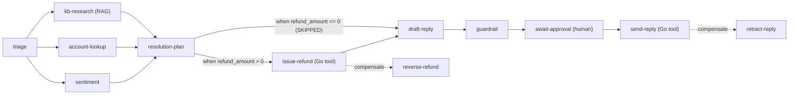

# Agent Pipeline Showcase: LLM agents on Plexus-Flow

[](https://github.com/avivklas/plexus-flow)
[](https://golang.org)
[](https://www.python.org)
[](#use-a-real-model)

> **Agents are non-deterministic. Your orchestration shouldn't be.**
>
> Let the model think freely *inside* a step. Let [plexus-flow](https://github.com/avivklas/plexus-flow) own everything *between* steps: ordering, parallelism, retries, timeouts, the human approval gate, and undoing what agents did when someone says no.

This showcase is a **support ticket resolver**: seven LLM agents plus two side-effecting tools. A refund is issued conditionally (`when: resolution-plan.refund_amount > 0`), then a guardrail or a human can still veto it, and plexus-flow reverses the refund automatically—or you can time-travel replay from any step with a patched payload without re-running upstream LLM calls. It runs offline with a deterministic mock model, or against any OpenAI-compatible endpoint.

```bash
./run_showcase.sh                 # all 8 scenarios in a few seconds, zero API keys
./run_showcase.sh --interactive   # you are the human reviewer
```

---

## The whole pipeline is one JSON file

[`flow.json`](flow.json) is the entire orchestration layer:

```json
{ "name": "triage",          "activity": "triage-agent",      "retries": 3, "timeout": "60s" },
{ "name": "kb-research",     "activity": "kb-research-agent", "retries": 5, "timeout": "60s", "depends_on": ["triage"],
  "retry_policy": { "initial_interval": "100ms", "backoff_coefficient": 2.0, "max_interval": "1s",
                    "non_retryable_error_codes": ["NO_POLICY", "LLM_BAD_REQUEST"] } },
{ "name": "account-lookup",  "activity": "account-agent",     "retries": 3, "timeout": "60s", "depends_on": ["triage"],
  "retry_policy": { "non_retryable_error_codes": ["UNKNOWN_CUSTOMER", "UNKNOWN_ORDER", "LLM_BAD_REQUEST"] } },
{ "name": "sentiment",       "activity": "sentiment-agent",   "retries": 3, "timeout": "60s", "depends_on": ["triage"] },
{ "name": "resolution-plan", "activity": "planner-agent",     "depends_on": ["triage", "kb-research", "account-lookup", "sentiment"] },
{ "name": "issue-refund",    "activity": "issue-refund",      "compensating_action": "reverse-refund", "depends_on": ["resolution-plan"],
  "when": { "source": "resolution-plan", "field": "refund_amount", "op": "gt", "value": 0 } },
{ "name": "draft-reply",     "activity": "draft-reply-agent", "depends_on": ["resolution-plan", "issue-refund"] },
{ "name": "guardrail",       "activity": "guardrail-agent",   "depends_on": ["resolution-plan", "draft-reply"],
  "retry_policy": { "non_retryable_error_codes": ["POLICY_VIOLATION", "LLM_BAD_REQUEST"] } },
{ "name": "await-approval",  "kind": "wait_signal", "signal": "approval", "timeout": "2m", "depends_on": ["guardrail"] },
{ "name": "send-reply",      "activity": "send-reply",        "compensating_action": "retract-reply", "depends_on": ["draft-reply", "await-approval"] }
```



## Every production concern is one line of config

| Concern in an agent system | In this repo | What you'd otherwise build |
|---|---|---|
| Run sub-agents in parallel, then join | `depends_on` | asyncio fan-out/fan-in, partial-failure handling |
| Conditional branching without replay determinism bugs | `"when": {"source": "resolution-plan", "field": "refund_amount", "op": "gt", "value": 0}` | Temporal `workflow.GetVersion` gates or scattered `if` branches across workers |
| Pass context between agents | `ctx.dependency_outputs` | a state object threaded through a graph framework |
| LLM rate limits (429), exponential backoff & non-retryable errors | `"retries": 5` + `"retry_policy"` | tenacity decorators, backoff timers, error-code filters |
| A model call that hangs | `"timeout": "60s"` | cancellation plumbing, watchdogs |
| Human approval | `"kind": "wait_signal"` | a DB table of pending approvals, a poller, a resume path |
| No one approves in time | `"timeout"` on the signal step | cron jobs that expire stale approvals ($O(\log N)$ min-heap timers) |
| Undo what an agent already did | `"compensating_action"` | hand-written rollback code for every failure path |
| Fix & re-run a failed step without paying for upstream LLM calls twice | `POST /api/v1/workflows/{id}/replay` (`replay_step`) | manual state surgery or re-running the entire pipeline from scratch |
| Process crashes mid-run (or mid-step) & zombie workers | Raft state + `Attempt`/`RunID` fencing + `ctx.report_progress(...)` | checkpointing tables, fencing tokens, idempotency keys |
| Zero-CDC search & live facets across workflows | `GET /api/v1/workflows/search` (`search_workflows`) | Elasticsearch/OpenSearch + Kafka CDC pipelines |
| Recurring scheduled runs & cold archival | `POST /api/v1/schedules` & `POST /api/v1/workflows/compact` | external cron runners, DB archival & retention jobs |
| See what happened in real time | dashboard at `/` + SSE `/watch` | tracing infrastructure, log correlation, polling loops |

## An agent is just a function

No agent framework, no graph DSL, no state class. Here is a complete agent from [`python/agents.py`](python/agents.py):

```python
@agent("sentiment-agent")
async def sentiment(ctx: TaskContext, t: dict[str, Any]) -> dict[str, Any]:
    out = await llm.complete(
        ctx,
        system="You assess customer sentiment for support tickets.",
        prompt=f"{ticket_text(t)}\n\nReturn JSON with keys: sentiment (calm|frustrated|angry), churn_risk (low|medium|high).",
        mock=..., chaos=t.get("chaos"),
    )
    llm.require(out, "sentiment", "churn_risk")   # malformed answer -> retryable failure -> plexus-flow retries
    return out
```

The planner reads its three upstream agents like this:

```python
tri, kb, acct, mood = (ctx.dependency_outputs[s] for s in ("triage", "kb-research", "account-lookup", "sentiment"))
```

[`python/llm.py`](python/llm.py) has no retry loop. A 429 becomes `ActivityFailure(code="RATE_LIMITED")`, and plexus-flow retries it.

---

## Architecture

```
                PLEXUS-FLOW ENGINE  (Raft state + gRPC worker broker + dashboard :8080)
                                   │ gRPC :9090
         ┌─────────────────────────┼─────────────────────────┐
         ▼                         ▼                         ▼
 PYTHON AGENT WORKER        GO TOOL WORKER             PLEXUS-SEARCH :8090
 triage, kb-research,       issue-refund  ↔ reverse    "kb" index, seeded from kb/*.md
 account, sentiment,        send-reply    ↔ retract    (RAG for kb-research)
 planner, draft, guardrail
```

Three design rules make it safe to let LLMs act:

1. **Agents propose, tools act, the orchestrator decides when.** Agents return JSON. Only the Go tool worker touches money or customers, and only when plexus-flow dispatches it. Every tool has a compensating action.
2. **The model chooses, code bounds.** `kb-research` lets the model pick a policy *ID*, but the refund percentages and caps are read from the article itself. The planner's proposed amount is clamped to the policy's automatic cap before any money moves.
3. **The agent loop lives inside a step.** A step can run any number of model or tool calls internally. The DAG between steps stays fixed, auditable and replayable.

---

## The eight scenarios

`./run_showcase.sh` runs them all, followed by a sub-millisecond zero-CDC faceted search query over the completed and compensated workflows. Output below is abridged from a real run.

### 1. `happy`: parallel research, refund, approval, reply

```text
[triage-agent] TCK-1001: category=damaged_item urgency=normal
[account-agent] TCK-1001: Maya Cohen (gold) flags=['high_value_customer']
[kb-research-agent] TCK-1001: plexus-search → KB-101 "Items damaged on arrival"
[sentiment-agent] TCK-1001: sentiment=frustrated churn_risk=medium
[planner-agent] TCK-1001: goodwill_partial_refund $47.25 (policy KB-101, cap $50)
[Payments] TCK-1001: 💸 refund RF-101000 of $47.25 issued to CUST-4417
[guardrail-agent] TCK-1001: ✅ reply is within policy
  • await-approval   RUNNING (waiting for signal 'approval')
[reviewer] dana@support APPROVED: "Looks good"
[Helpdesk] TCK-1001: ✉️  reply MSG-416000 sent (approved by dana@support)
✔ COMPLETED
```

### 2. `warranty-skip`: declarative `when` guard skips `issue-refund`

```text
[kb-research-agent] TCK-1005: plexus-search → KB-107 "Warranty claims for faulty products"
[planner-agent] TCK-1005: escalate $0.00 (policy KB-107, cap $0)
  • resolution-plan  COMPLETED
  • issue-refund     SKIPPED (when resolution-plan.refund_amount gt 0 → false)
  • draft-reply      RUNNING
[draft-reply-agent] TCK-1005: drafted "Re: Espresso machine stopped working under warranty"
✔ COMPLETED: warranty escalation sent; issue-refund skipped declaratively (`when` guard).
```

### 3. `flaky-llm`: the provider rate-limits you

```text
    ⚠ kb-research: provider returned 429 Too Many Requests (attempt 1)
    ⚠ kb-research: provider returned 429 Too Many Requests (attempt 2)
  • kb-research      RUNNING (attempt 3)
[kb-research-agent] TCK-1002: plexus-search → KB-102 "Late or delayed deliveries"
  • kb-research      COMPLETED (attempt 3)
✔ COMPLETED
```

The other two parallel agents were never affected, and nothing upstream re-ran.

### 4. `guardrail`: the draft over-promises, money comes back

```text
[Payments] TCK-1003: 💸 refund RF-531000 of $119.00 issued to CUST-7781
[guardrail-agent] TCK-1003: 🛑 VETO: forbidden promise: 'free month'
[Payments ↩ COMPENSATION] refund RF-531000 of $119.00 reversed for CUST-7781
↩ COMPENSATED (POLICY_VIOLATION)
```

### 5. `guardrail-replay`: time-travel step replay with patched input

```text
↩ COMPENSATED (POLICY_VIOLATION)
⏪ [time-travel replay] replaying workflow TCK-1003-guardrail-replay from 'draft-reply' with clean input
[Payments] TCK-1003: 💸 refund RF-842000 of $119.00 issued to CUST-7781
[draft-reply-agent] TCK-1003: drafted "Re: Charged twice for my subscription!!" (48 words)
[guardrail-agent] TCK-1003: ✅ reply is within policy
✔ COMPLETED

  LLM call ledger (one line per model call):
    triage           1 call(s)  ✓ once (cached in Raft)
    kb-research      1 call(s)  ✓ once (cached in Raft)
    account-lookup   1 call(s)  ✓ once (cached in Raft)
    sentiment        1 call(s)  ✓ once (cached in Raft)
    resolution-plan  1 call(s)  ✓ once (cached in Raft)
    draft-reply      2 call(s)  ← replayed after input patch
    guardrail        2 call(s)  ← replayed after input patch
```

### 6. `human-reject`: the reviewer sees what agents missed

```text
│ action: goodwill_partial_refund  refund: $44.75  flags: ['repeat_refunds']
[reviewer] lead@support REJECTED: "4 refunds in 90 days, send to fraud review"
[Payments ↩ COMPENSATION] refund RF-693000 of $44.75 reversed for CUST-3355
↩ COMPENSATED (REJECTED_BY_HUMAN)
```

A signal payload isn't a failure. `send-reply` turns `approved: false` into a permanent failure with one `if`, and the saga does the rest.

### 7. `crash-resume`: SIGKILL the agent worker mid-run

```text
  • draft-reply      RUNNING
💥 [chaos] SIGKILL python agent worker (pid 3360) while draft-reply is in flight
♻️  [chaos] restarting python agent worker: plexus-flow redelivers the lost task
[draft-reply-agent] TCK-1001: ♻️  resumed from heartbeat checkpoint {'stage': 'context_prepared', 'action': 'goodwill_partial_refund', 'refund_id': 'RF-425000', 'amount': 47.25}
[draft-reply-agent] TCK-1001: drafted "Re: Espresso machine arrived cracked"
✔ COMPLETED
  ♻️  Heartbeat checkpoint preserved across worker crash (draft-reply): {'stage': 'context_prepared', 'action': 'goodwill_partial_refund', 'refund_id': 'RF-425000', 'amount': 47.25}

  LLM call ledger (one line per model call; pids show the worker restart):
    triage           1 call(s)  pids=[3360]  ✓ once
    kb-research      1 call(s)  pids=[3360]  ✓ once
    account-lookup   1 call(s)  pids=[3360]  ✓ once
    sentiment        1 call(s)  pids=[3360]  ✓ once
    resolution-plan  1 call(s)  pids=[3360]  ✓ once
    draft-reply      2 call(s)  pids=[3360, 3382]  ← in flight during the crash, re-run
    guardrail        1 call(s)  pids=[3382]  ✓ once
```

Five finished LLM calls were not paid for twice, the in-flight step resumed with its last heartbeat checkpoint (`ctx.last_progress`), and the refund was not issued twice. Results are committed through Raft, and the refund tool is idempotent per workflow.

### 8. `timeout`: nobody answers

```text
  • await-approval   FAILED
    └─ SIGNAL_TIMEOUT: timed out waiting for signal "approval"
↩ COMPENSATED (SIGNAL_TIMEOUT)
  refund RF-226000 of $47.25 was reversed automatically. No money leaked.
```

While parked on `wait_signal`, the workflow holds no worker, thread or connection. It is only a row in replicated state.

---

## Quick start

Prerequisites: Go 1.27+, [uv](https://docs.astral.sh/uv/), and sibling checkouts:

```
avivklas/
  plexus/                   # required (plexus-flow depends on it)
  plexus-flow/              # required
  plexus-search/            # optional: without it the KB falls back to in-memory search
  agent-pipeline-showcase/  # this repo
```

```bash
./run_showcase.sh                          # all scenarios, automatic reviewer
./run_showcase.sh --interactive            # approve/reject each ticket yourself
./run_showcase.sh --scenario crash-resume  # one scenario
./run_showcase.sh --no-block               # exit when done instead of keeping services up
```

Then open **http://127.0.0.1:8080** for the flow graph (with failure, conditional `when`, and compensation edges), live zero-CDC faceted search, and one-click step replay.

If the default ports are busy, override them:

```bash
HTTP_ADDR=127.0.0.1:18080 GRPC_ADDR=127.0.0.1:19090 RAFT_ADDR=127.0.0.1:19000 ACT_RAFT_ADDR=127.0.0.1:19001 ./run_showcase.sh
```

### Use a real model

Any OpenAI-compatible `/chat/completions` endpoint works:

```bash
# OpenAI
PLEXUS_LLM=openai OPENAI_API_KEY=sk-... OPENAI_MODEL=gpt-4o-mini ./run_showcase.sh

# Ollama / vLLM / LM Studio
PLEXUS_LLM=openai OPENAI_BASE_URL=http://localhost:11434/v1 OPENAI_MODEL=llama3.1 ./run_showcase.sh
```

The chaos scenarios (429s, the off-policy draft, the slow model) are injected the same way for every backend. With a real model, the guardrail's LLM judge runs alongside its deterministic checks.

### Run the pieces by hand

```bash
go build -o bin/plexus-flow github.com/avivklas/plexus-flow/cmd/plexus-flow
bin/plexus-flow --http-addr 127.0.0.1:8080 --grpc-addr 127.0.0.1:9090 --data-dir data/flow
go run ./go --grpc-addr 127.0.0.1:9090                     # Go tool worker
uv run python python/agents.py --grpc-addr 127.0.0.1:9090  # Python agent worker
uv run python python/launcher.py --scenario happy          # submit a ticket
```

Approve a parked ticket yourself:

```bash
curl -X POST http://127.0.0.1:8080/api/v1/workflows/<workflow-id>/signal \
  -d '{"signal_name":"approval","payload":{"approved":true,"reviewer":"you"}}'
```

---

## How does it scale?

[`bench/`](bench/) measures how latency responds to worker slots (`--max-concurrency`), worker fleet size, parallel workflow bursts, pipeline DAG size, and engine uptime, using the real 10-step pipeline with the mock model. Headline: **2.7 ms p50 (`0.33 ms/step`) for the whole 10-step pipeline** at low load, **1,024 concurrent workflows within 1.5× baseline p95 (`1,474 ms` vs. `1,075 ms` baseline at `150 ms`/step)** across 8 workers × 128 slots (`646.4 wf/s`), and a single-node coordinator ceiling of **1,085 workflows/s (10,849 steps/s)** with single-commit atomic step advancement and automatic `ActivityStore` pruning. See [bench/README.md](bench/README.md) for the findings and [bench/RESULTS.md](bench/RESULTS.md) for charts.

```bash
uv run python bench/bench.py --quick
```

## Repository layout

```
flow.json              the pipeline (the only orchestration code)
python/agents.py       7 agents, each a plain async function
python/llm.py          mock + OpenAI-compatible backend, chaos injection, call ledger
python/kb.py           plexus-search client with in-memory fallback, seeding CLI
python/launcher.py     scenarios: submit tickets, act as reviewer, replay steps, kill/restart worker
go/tools/refund.go     issue-refund / reverse-refund (typed Go structs, idempotent ledger)
go/tools/reply.go      send-reply / retract-reply (typed Go structs)
kb/*.md                support policy articles (indexed into plexus-search)
fixtures/              customers and tickets
run_showcase.sh        build, boot, seed, run
bench/                 scale benchmark: driver, report generator, results
```

## Honest limits

- **Declarative conditional branching (`when`), no unbounded runtime cycles.** Steps can branch conditionally on input, metadata, or upstream step outputs (`when`), and untaken branches are marked `SKIPPED` while downstream join steps advance. Put open-ended loops inside a step (an agent's tool-use loop) and keep the graph between steps a declarative DAG.
- **Durations.** The engine's JSON uses nanoseconds. `flow.json` uses readable strings (`"60s"`, `"100ms"`), and the launcher converts them (`to_ns` in `launcher.py`).
- **The tools are simulations.** The ledger and outbox live in memory in the Go worker. Swap in Stripe and your helpdesk API, keeping the idempotency key (the workflow ID).
