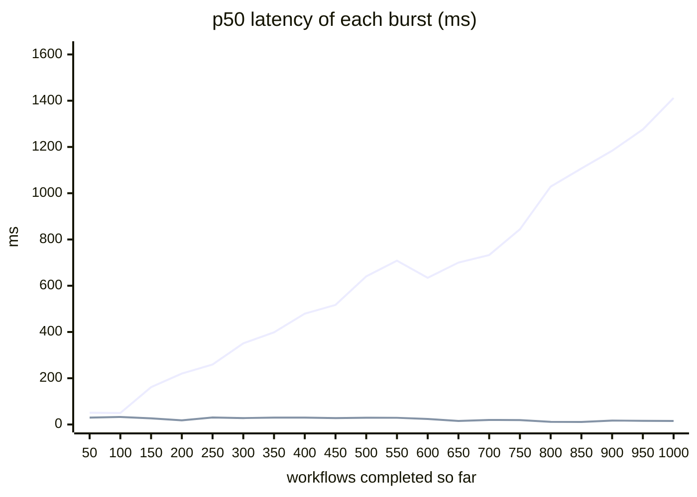
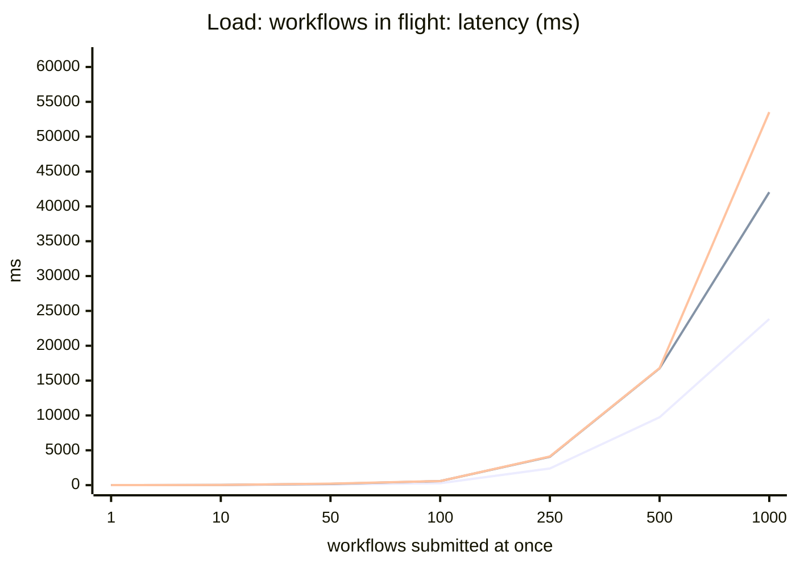
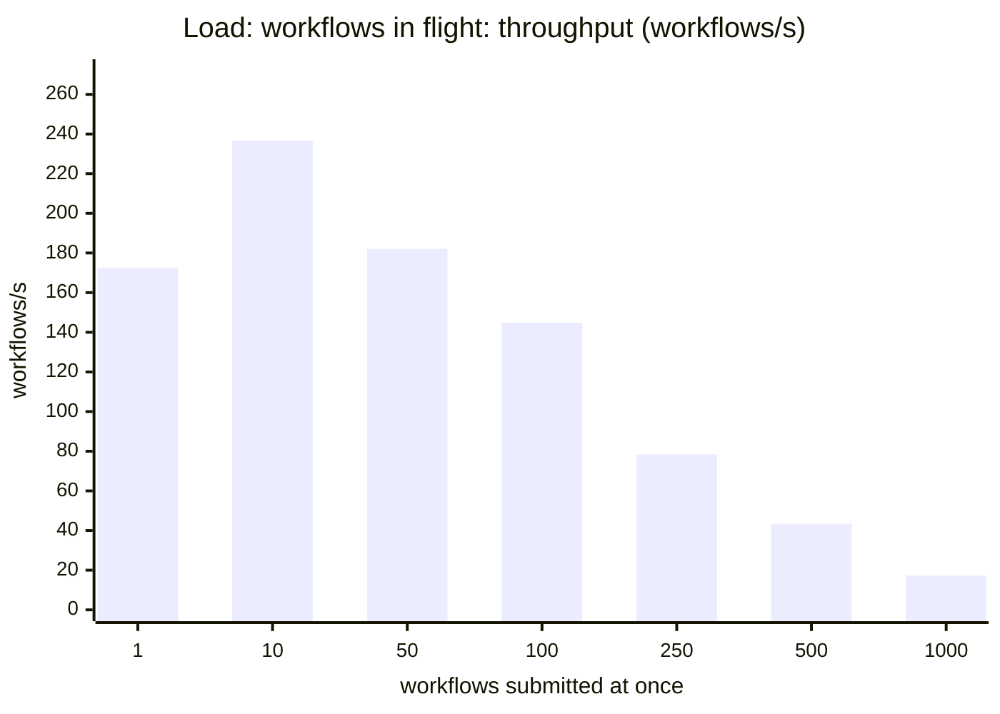
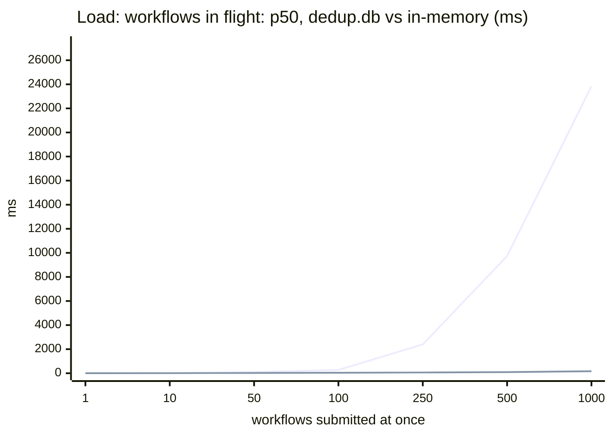
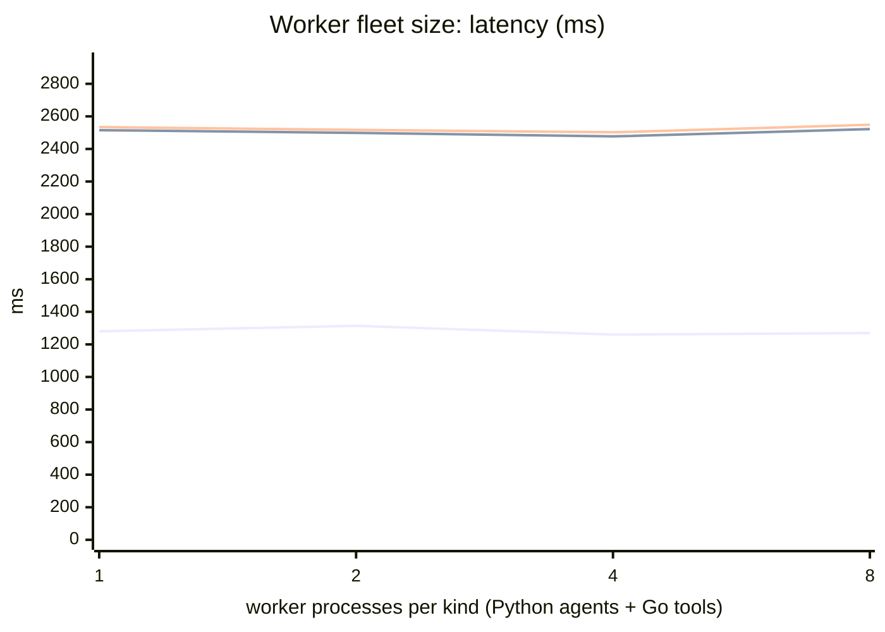
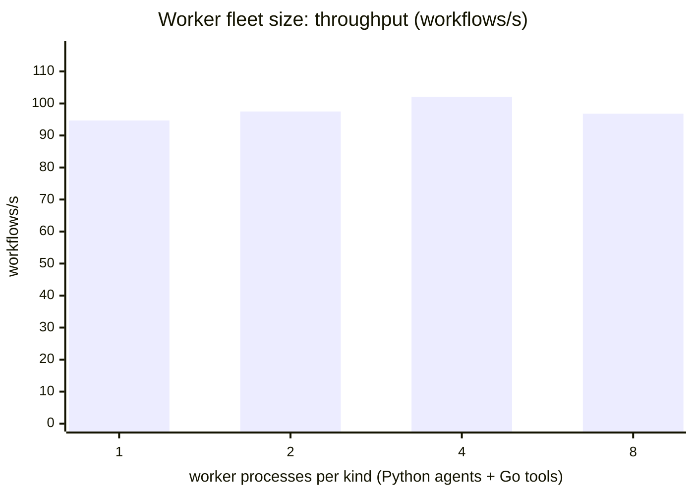
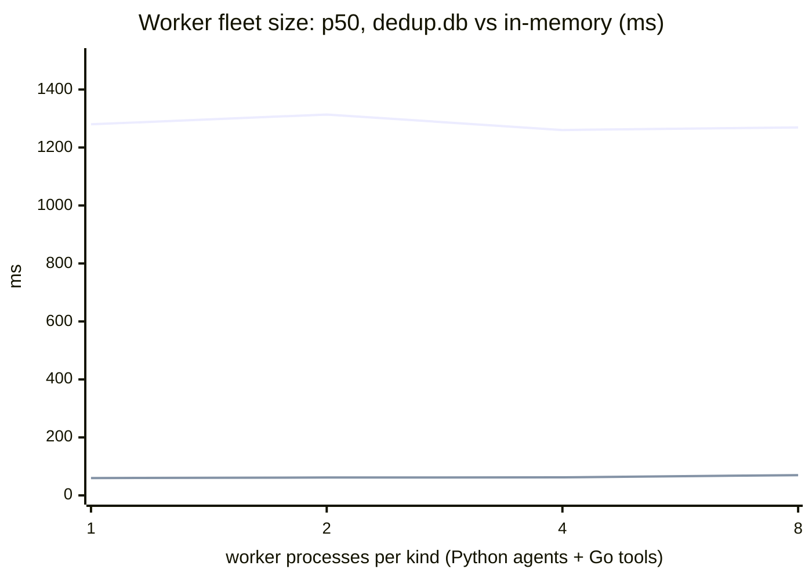
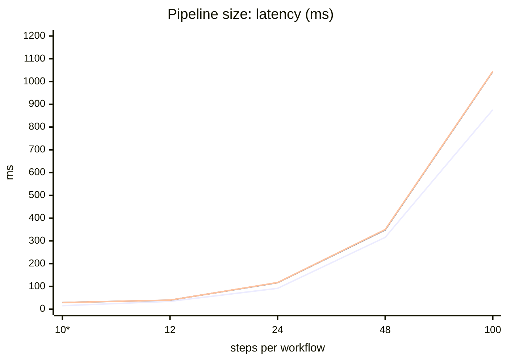
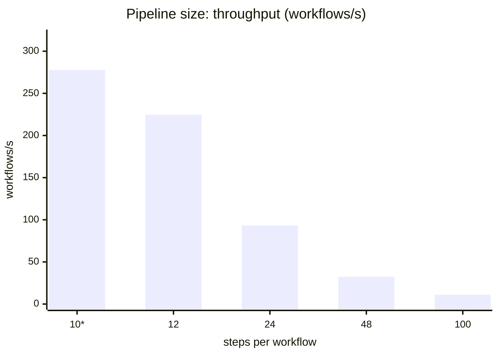
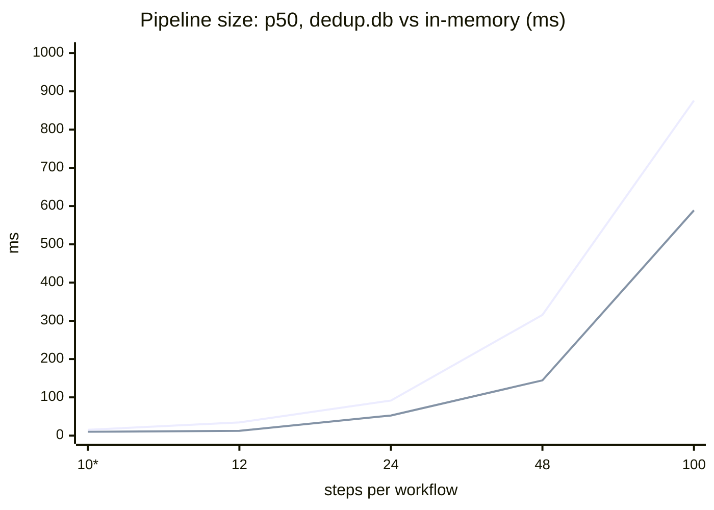

# Benchmark: how scale affects latency

Generated from [`20261016-143836.json`](results/20261016-143836.json) by `bench/report.py`.

**Machine:** Apple M5 Pro · 15 cores · Darwin 25.6.0 · Go go1.27.0 darwin/arm64 · Python 3.13.13 · plexus-flow `1fe2e44 (fix/idempotent-step-dispatch)` · dedup store: file (default) · 2026-10-16T14:34:39

**What is measured.** End-to-end workflow latency from the engine's own timestamps (created → completed), with the mock LLM answering instantly and per-step logging off, so the numbers are pure orchestration cost: Raft commits on two consensus groups, dispatch to gRPC workers, dependency resolution and the approval signal. Every data point runs on a freshly started single-node engine and worker fleet, after one warm-up workflow. Each point submits N workflows at once (a burst), waits for all of them, and repeats until at least 30 workflows have run; throughput is runs / time spent inside bursts.

Charts: lines are p50 (lowest), p95 and p99 (highest).

## History: identical bursts back to back

Bursts of 50 real agent-pipeline workflows run one after another on the same engine. Nothing about the load changes between bursts, so a flat line is the expected result.

Lines: dedup store as shipped (`dedup.db`, rising) and the in-memory dedup store (flat).

| workflows so far | 50 | 100 | 150 | 200 | 250 | 300 | 350 | 400 | 450 | 500 | 550 | 600 | 650 | 700 | 750 | 800 | 850 | 900 | 950 | 1000 |
|---|---:|---:|---:|---:|---:|---:|---:|---:|---:|---:|---:|---:|---:|---:|---:|---:|---:|---:|---:|---:|
| p50, dedup.db (ms) | 51 | 50 | 162 | 220 | 259 | 351 | 399 | 479 | 517 | 640 | 708 | 634 | 700 | 733 | 844 | 1029 | 1107 | 1184 | 1276 | 1412 |
| p50, in-memory dedup (ms) | 30 | 32 | 26 | 18 | 30 | 28 | 30 | 30 | 28 | 29 | 29 | 24 | 15 | 20 | 19 | 12 | 11 | 17 | 16 | 16 |

## Load: workflows in flight

Real 10-step agent pipeline (incl. approval signal), 4 Python + 2 Go workers × 32 concurrent tasks.

p50 as shipped (higher line) vs. with the in-memory dedup store (lower line):

| workflows submitted at once | runs | p50 | p95 | p99 | max | per step (p50) | workflows/s | steps/s | p50 (mem dedup) | p99 (mem dedup) | wf/s (mem dedup) |
|---:|---:|---:|---:|---:|---:|---:|---:|---:|---:|---:|---:|
| 1 | 30 | 5.7 ms | 7.2 ms | 8.8 ms | 9.3 ms | 0.71 ms | 172.6 | 1726 | 4.5 ms | 5.9 ms | 216.1 |
| 10 | 30 | 14.8 ms | 36.8 ms | 36.9 ms | 36.9 ms | 1.85 ms | 236.7 | 2367 | 8.4 ms | 23.7 ms | 369.2 |
| 50 | 150 | 91.8 ms | 180.2 ms | 213.1 ms | 220.0 ms | 11.47 ms | 182.1 | 1821 | 25.5 ms | 163.4 ms | 289.6 |
| 100 | 300 | 279.6 ms | 582.6 ms | 587.5 ms | 588.1 ms | 34.95 ms | 144.8 | 1448 | 41.3 ms | 310.2 ms | 294.6 |
| 250 | 750 | 2393.7 ms | 4080.0 ms | 4112.1 ms | 4132.1 ms | 299.21 ms | 78.4 | 784 | 63.1 ms | 691.8 ms | 295.8 |
| 500 | 1500 | 9736.0 ms | 16757.4 ms | 16798.2 ms | 16858.0 ms | 1217.00 ms | 43.4 | 434 | 93.9 ms | 1426.0 ms | 287.9 |
| 1000 ⚠ | 2051 | 23839.1 ms | 42035.6 ms | 53525.8 ms | 56651.6 ms | 2979.89 ms | 17.3 | 173 | 164.0 ms | 3134.9 ms | 261.3 |

## Worker fleet size

Real agent pipeline at a fixed load, each worker running at most 8 tasks at a time.

p50 as shipped (higher line) vs. with the in-memory dedup store (lower line):

| worker processes per kind (Python agents + Go tools) | runs | p50 | p95 | p99 | max | per step (p50) | workflows/s | steps/s | p50 (mem dedup) | p99 (mem dedup) | wf/s (mem dedup) |
|---:|---:|---:|---:|---:|---:|---:|---:|---:|---:|---:|---:|
| 1 | 600 | 1280.0 ms | 2515.4 ms | 2534.6 ms | 2549.5 ms | 160.00 ms | 94.7 | 947 | 59.9 ms | 499.1 ms | 332.0 |
| 2 | 600 | 1313.7 ms | 2498.5 ms | 2517.1 ms | 2542.2 ms | 164.21 ms | 97.5 | 975 | 61.7 ms | 571.7 ms | 301.2 |
| 4 | 600 | 1260.3 ms | 2477.1 ms | 2502.2 ms | 2521.9 ms | 157.53 ms | 102.1 | 1021 | 62.2 ms | 561.8 ms | 308.8 |
| 8 | 600 | 1269.1 ms | 2521.8 ms | 2548.7 ms | 2564.2 ms | 158.64 ms | 96.8 | 968 | 69.9 ms | 562.4 ms | 306.2 |

## Pipeline size

10 workflows in flight. `10*` is the real agent pipeline; the rest are synthetic fork-join DAGs of no-op steps (one step fans out to three, which join into the next).

p50 as shipped (higher line) vs. with the in-memory dedup store (lower line):

| steps per workflow | runs | p50 | p95 | p99 | max | per step (p50) | workflows/s | steps/s | p50 (mem dedup) | p99 (mem dedup) | wf/s (mem dedup) |
|---:|---:|---:|---:|---:|---:|---:|---:|---:|---:|---:|---:|
| 10* | 30 | 15.2 ms | 29.1 ms | 29.3 ms | 29.4 ms | 1.89 ms | 277.7 | 2777 | 10.0 ms | 20.5 ms | 362.0 |
| 12 | 30 | 34.5 ms | 39.7 ms | 39.8 ms | 39.8 ms | 5.76 ms | 224.5 | 2694 | 12.5 ms | 21.9 ms | 428.0 |
| 24 | 30 | 91.6 ms | 116.4 ms | 117.1 ms | 117.3 ms | 7.63 ms | 93.1 | 2235 | 52.5 ms | 70.1 ms | 145.6 |
| 48 | 30 | 315.5 ms | 348.3 ms | 350.0 ms | 350.6 ms | 13.14 ms | 32.4 | 1556 | 144.4 ms | 159.0 ms | 63.9 |
| 100 | 30 | 876.0 ms | 1043.6 ms | 1044.6 ms | 1044.8 ms | 17.52 ms | 11.1 | 1114 | 588.9 ms | 627.4 ms | 16.3 |

⚠ = some runs failed or were unfinished when the per-point time budget (120 s) ran out; their latency is not included, so the real numbers for that point are worse.
