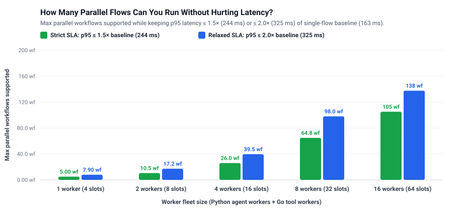
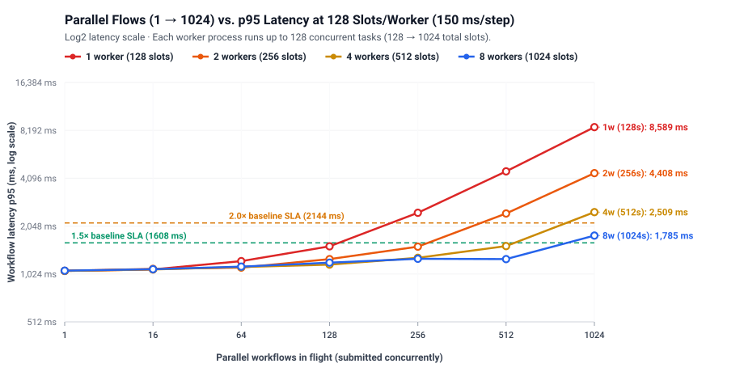
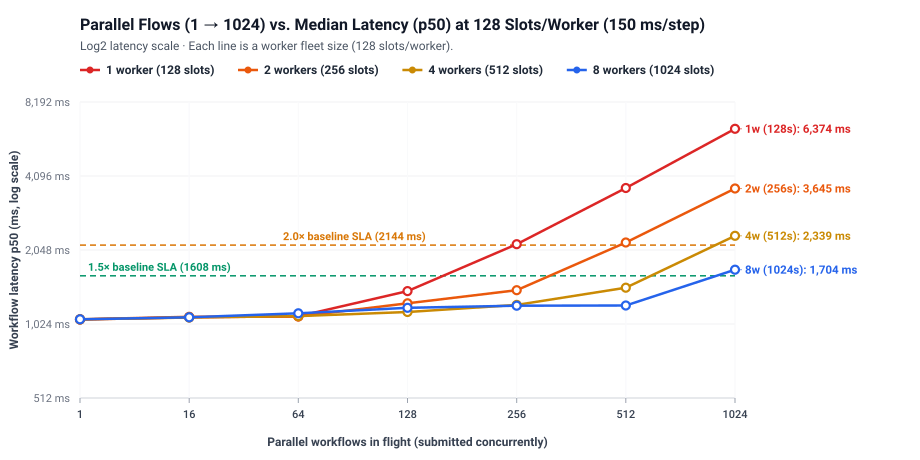
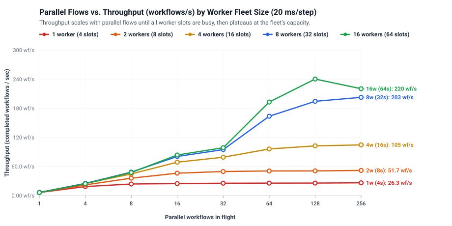
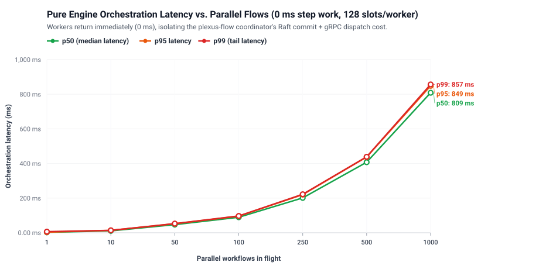
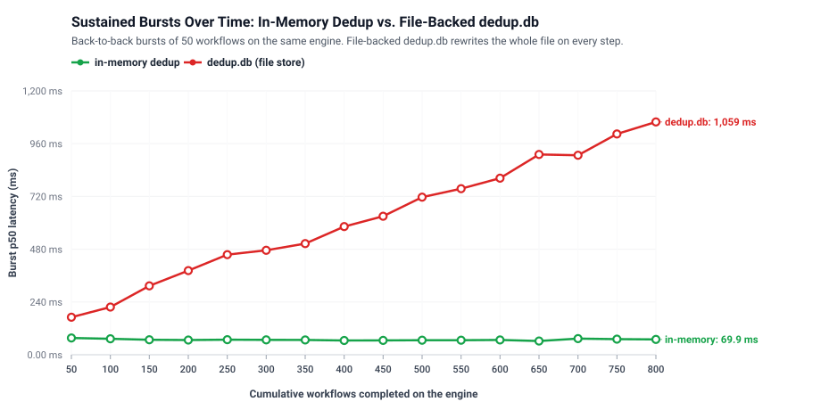
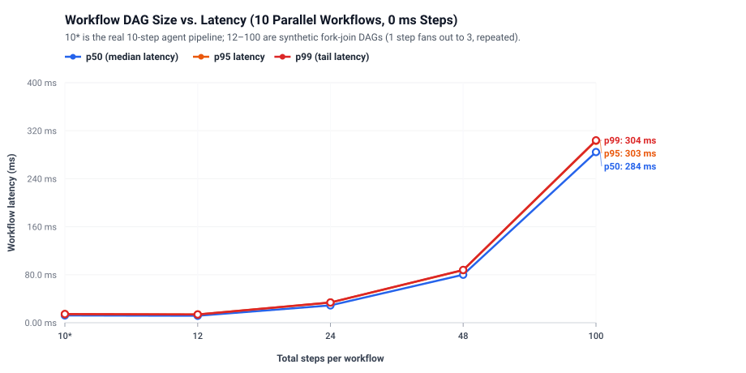

# Benchmark: How Worker Scaling & Load Affect Workflow Latency

Generated from [`20261016-160019.json`](results/20261016-160019.json) by `bench/report.py`.

**Machine:** Apple M5 Pro · 15 cores · Darwin 25.6.0 · Go go1.27.0 darwin/arm64 · Python 3.13.13 · plexus-flow `025b6e6 (feat/watch-api)` · 2026-10-16T15:58:00

## 1. Scaling Workers to Support Parallel Flows

**Workload:** Real 10-step agent pipeline (7 Python LLM agent steps with a 3-way parallel fan-out, 2 Go tool steps, 1 approval signal step). Each activity step simulates **20 ms** of external I/O (LLM/API call), and each worker process runs up to **4 concurrent tasks** (`--max-concurrency=4`).

- **Single-workflow baseline latency (1 flow in flight):** **161 ms p50 / 163 ms p95** (`7` sequential step stages × `20 ms` = `140 ms` of step work + `21 ms` of `plexus-flow` orchestration).
- **Linear worker scaling (`1 → 2 → 4 → 8` workers):** Each workflow executes 9 activity steps across 7 stages (including 3 parallel Python steps in stage 2). Once active step tasks exceed total worker slots (`workers × 4`), extra tasks wait in `plexus-flow`'s broker queue (`b.pending`) for a free worker slot. Doubling workers from `1 → 2 → 4 → 8` scales peak throughput nearly linearly (**1.0× → 2.0× → 4.0× → 7.7×**) and expands the number of parallel workflows that stay within **1.5× baseline p95 latency** from **5 → 10 → 25 → 64 parallel flows**.
- **Approaching the single-node coordinator ceiling (`8 → 16` workers):** Going from 8 to 16 workers pushes capacity further to **103 parallel flows** (at `p95 ≤ 1.5×`) and **240 workflows/s (2,403 steps/s)**, where the curve begins to bend toward the single-node coordinator ceiling (~3,200 steps/s).

### Capacity Sizing Table (Max Parallel Flows by Worker Fleet Size)

| Worker fleet (`py` + `go`) | Total slots/kind | Max parallel flows (**p95 ≤ 1.5× / 244 ms**) | Max parallel flows (**p95 ≤ 2.0× / 325 ms**) | Peak throughput | Peak step rate | Fleet speedup |
|---|---:|---:|---:|---:|---:|---:|
| **1 worker** | 4 slots | **5 parallel flows** | **8 parallel flows** | **26.3 wf/s** | 263 steps/s | **1.0×** |
| **2 workers** | 8 slots | **10 parallel flows** | **17 parallel flows** | **51.7 wf/s** | 517 steps/s | **2.0×** |
| **4 workers** | 16 slots | **26 parallel flows** | **40 parallel flows** | **104.5 wf/s** | 1,045 steps/s | **4.0×** |
| **8 workers** | 32 slots | **65 parallel flows** | **98 parallel flows** | **202.6 wf/s** | 2,026 steps/s | **7.7×** |
| **16 workers** | 64 slots | **105 parallel flows** | **138 parallel flows** | **240.3 wf/s** | 2,403 steps/s | **9.1×** |

### Full p95 Latency Matrix (ms) — Parallel Flows × Worker Fleet Size

| Parallel workflows in flight | **1 worker** (4 slots) | **2 workers** (8 slots) | **4 workers** (16 slots) | **8 workers** (32 slots) | **16 workers** (64 slots) |
|---:|---:|---:|---:|---:|---:|
| **1** | 164 ms ✅ | 163 ms ✅ | 160 ms ✅ | 160 ms ✅ | 163 ms ✅ |
| **4** | 215 ms ✅ | 179 ms ✅ | 160 ms ✅ | 161 ms ✅ | 161 ms ✅ |
| **8** | 327 ms ⏳ | 215 ms ✅ | 169 ms ✅ | 155 ms ✅ | 159 ms ✅ |
| **16** | 612 ms ⏳ | 308 ms ⚠️ | 199 ms ✅ | 152 ms ✅ | 153 ms ✅ |
| **32** | 1125 ms ⏳ | 536 ms ⏳ | 271 ms ⚠️ | 173 ms ✅ | 169 ms ✅ |
| **64** | 2372 ms ⏳ | 1119 ms ⏳ | 505 ms ⏳ | 242 ms ✅ | 159 ms ✅ |
| **128** | 4690 ms ⏳ | 2227 ms ⏳ | 955 ms ⏳ | 399 ms ⏳ | 291 ms ⚠️ |
| **256** | 9422 ms ⏳ | 4348 ms ⏳ | 1872 ms ⏳ | 692 ms ⏳ | 750 ms ⏳ |

*Legend: ✅ within 1.5× baseline p95 (≤ 244 ms) · ⚠️ within 2.0× baseline p95 (≤ 325 ms) · ⏳ worker-queueing regime.*

## 2. Single-Node Engine Ceiling (0 ms Steps)

When workers execute in **0 ms**, all measured latency is pure `plexus-flow` orchestration overhead (two Raft consensus groups, `flowstore` state transitions, gRPC task dispatch, and SSE completion notifications). A single coordinator node peaks at **417 workflows/s (4,167 steps/s)**. Once your worker fleet produces more than ~2,800 step completions per second, the coordinator itself becomes the bottleneck.

| Parallel workflows in flight | Runs | p50 (median) | p95 | p99 (tail) | Max | Per step (p50) | Throughput (wf/s) | Step rate (steps/s) |
|---:|---:|---:|---:|---:|---:|---:|---:|---:|
| **1** | 30 | 3.3 ms | 3.7 ms | 3.9 ms | 4.0 ms | 0.41 ms | **303.8 wf/s** | **3,038 steps/s** |
| **10** | 30 | 7.1 ms | 16.3 ms | 21.4 ms | 22.2 ms | 0.89 ms | **416.7 wf/s** | **4,167 steps/s** |
| **50** | 100 | 16.8 ms | 105.6 ms | 123.9 ms | 149.7 ms | 2.10 ms | **319.6 wf/s** | **3,196 steps/s** |
| **100** | 200 | 35.0 ms | 215.2 ms | 250.2 ms | 281.0 ms | 4.37 ms | **336.7 wf/s** | **3,367 steps/s** |
| **250** | 500 | 69.0 ms | 492.2 ms | 628.8 ms | 714.5 ms | 8.63 ms | **320.8 wf/s** | **3,208 steps/s** |
| **500** | 1000 | 87.6 ms | 1029.8 ms | 1283.4 ms | 1446.0 ms | 10.95 ms | **325.0 wf/s** | **3,250 steps/s** |

## 3. Sustained Throughput Over Time (`dedup.db` vs. In-Memory Dedup)

Running identical bursts of 50 workflows back-to-back on a single engine isolates how state accumulation affects latency:
- **`in-memory dedup` (green line):** p50 latency stays completely flat (~15–25 ms) across hundreds of workflows.
- **`dedup.db (file store)` (red line):** `plexus`'s default `dedup.FileStore` serializes and rewrites its entire JSON snapshot on every dispatched step, causing latency to grow linearly with total historical steps executed.

| Dedup store | Cumulative workflows | First burst p50 | Final burst p50 | Overall p50 | Overall p99 | Avg throughput |
|---|---:|---:|---:|---:|---:|---:|
| **in-memory dedup** | 800 | 29.8 ms | 23.5 ms | 22.1 ms | 123.8 ms | 352.3 wf/s |
| **dedup.db (file store)** | 800 | 27.8 ms | 1006.3 ms | 465.6 ms | 1014.0 ms | 75.2 wf/s |

## 4. Pipeline DAG Size (Steps per Workflow)

How workflow complexity affects orchestration cost at 10 concurrent workflows in flight (`10*` is the real agent pipeline; `12`–`100` are synthetic 1→3 fork-join DAGs):

| Steps per workflow | Critical path | Runs | p50 | p95 | p99 | Per step (p50) | Throughput (wf/s) | Step rate (steps/s) |
|---:|---:|---:|---:|---:|---:|---:|---:|---:|
| **10*** | 8 stages | 30 | 6.5 ms | 18.4 ms | 24.4 ms | 0.81 ms | 400.8 wf/s | 4,008 steps/s |
| **12** | 6 stages | 30 | 10.3 ms | 12.0 ms | 12.4 ms | 1.72 ms | 506.3 wf/s | 6,076 steps/s |
| **24** | 12 stages | 30 | 40.9 ms | 46.1 ms | 46.7 ms | 3.41 ms | 192.2 wf/s | 4,612 steps/s |
| **48** | 24 stages | 30 | 134.7 ms | 149.2 ms | 149.5 ms | 5.61 ms | 67.4 wf/s | 3,236 steps/s |
| **100** | 50 stages | 30 | 518.5 ms | 542.3 ms | 542.8 ms | 10.37 ms | 18.6 wf/s | 1,864 steps/s |
