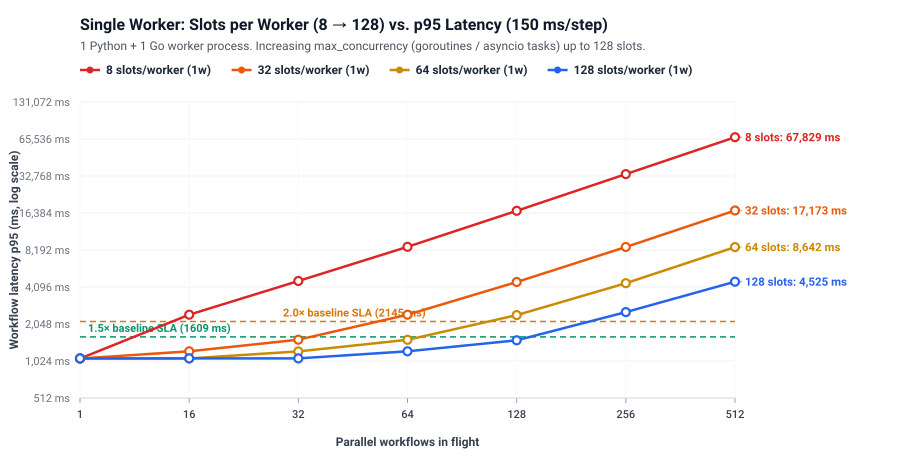

# Benchmark: How Worker Slots, Fleet Size & Load Affect Workflow Latency

Generated from [`20261017-090316.json`](results/20261017-090316.json) by `bench/report.py`.

**Machine:** Apple M5 Pro · 15 cores · Darwin 25.6.0 · Go go1.27.0 darwin/arm64 · Python 3.13.13 · plexus-flow `025b6e6 (feat/watch-api)` · 2026-10-17T08:56:27

## What is a "Slot" (`--max-concurrency`)?

When a worker connects to `plexus-flow` over gRPC (`WorkerService.Connect`), it registers with a `max_concurrency` limit—its **slots**:
- **In the Go worker (`pkg/workerclient`):** Each slot is a concurrent **goroutine** executing an activity handler (`MaxConcurrency`).
- **In the Python worker (`plexus_flow.Worker`):** Each slot is a concurrent **`asyncio.Task`** on the event loop (`max_concurrency`).
- **In the `plexus-flow` Broker (`pkg/remote/broker.go`):** The broker tracks `len(session.inflight) < session.max` per connected worker. As long as a worker has free slots, the broker streams tasks to it immediately; once all slots across all workers are full, new tasks wait in `broker.pending[activity]`.

## 1. Scaling Slots Within a Single Worker (`8 → 32 → 64 → 128` Slots/Worker)

Because LLM and tool steps are I/O-bound (`150 ms` per step), a single worker process can hold many concurrent tasks in flight at once (goroutines in Go, `asyncio.Task`s in Python). Increasing `--max-concurrency` from `8` to `128` slots on **just 1 worker process per kind** dramatically increases how many parallel workflows it can handle before queueing:

| Slots per worker (1 process/kind) | Max parallel flows (**p95 ≤ 1.5× / 1609 ms**) | Max parallel flows (**p95 ≤ 2.0× / 2146 ms**) | Peak throughput | Peak step rate |
|---|---:|---:|---:|---:|
| **8 slots/worker** | **8 parallel flows** | **14 parallel flows** | **7.5 wf/s** | 75 steps/s |
| **32 slots/worker** | **35 parallel flows** | **54 parallel flows** | **29.7 wf/s** | 297 steps/s |
| **64 slots/worker** | **69 parallel flows** | **106 parallel flows** | **57.5 wf/s** | 575 steps/s |
| **128 slots/worker** | **138 parallel flows** | **214 parallel flows** | **111.1 wf/s** | 1,111 steps/s |

## 2. Scaling Worker Fleet at `128` Slots/Worker (Up to `1,024` Parallel Workflows)

**Workload:** Real 10-step agent pipeline (`150 ms` simulated I/O per step, **128 concurrent slots per worker process**). Single-workflow baseline latency is **1070 ms p50 / 1072 ms p95** (`7 × 150 ms = 1050 ms` of step work).

### Capacity Sizing Table (`128` Slots/Worker, `150 ms`/Step)

| Worker fleet (`py` + `go`) | Total slots/kind | Max parallel flows (**p95 ≤ 1.5× / 1608 ms**) | Max parallel flows (**p95 ≤ 2.0× / 2144 ms**) | Peak throughput | Peak step rate | Fleet speedup |
|---|---:|---:|---:|---:|---:|---:|
| **1 worker** | 128 slots | **139 parallel flows** | **210 parallel flows** | **117.1 wf/s** | 1,171 steps/s | **1.0×** |
| **2 workers** | 256 slots | **280 parallel flows** | **426 parallel flows** | **221.3 wf/s** | 2,213 steps/s | **1.9×** |
| **4 workers** | 512 slots | **551 parallel flows** | **832 parallel flows** | **389.9 wf/s** | 3,899 steps/s | **3.3×** |
| **8 workers** | 1,024 slots | **847 parallel flows** | **1024 parallel flows** | **537.7 wf/s** | 5,377 steps/s | **4.6×** |

### Full p95 Latency Matrix (ms) — Parallel Flows × Worker Fleet Size (`128` Slots/Worker)

| Parallel workflows in flight | **1 worker** (128 slots) | **2 workers** (256 slots) | **4 workers** (512 slots) | **8 workers** (1,024 slots) |
|---:|---:|---:|---:|---:|
| **1** | 1071 ms ✅ | 1072 ms ✅ | 1070 ms ✅ | 1074 ms ✅ |
| **16** | 1095 ms ✅ | 1102 ms ✅ | 1094 ms ✅ | 1098 ms ✅ |
| **64** | 1233 ms ✅ | 1123 ms ✅ | 1132 ms ✅ | 1139 ms ✅ |
| **128** | 1529 ms ✅ | 1271 ms ✅ | 1173 ms ✅ | 1207 ms ✅ |
| **256** | 2484 ms ⏳ | 1520 ms ✅ | 1294 ms ✅ | 1276 ms ✅ |
| **512** | 4524 ms ⏳ | 2458 ms ⏳ | 1534 ms ✅ | 1270 ms ✅ |
| **1,024** | 8589 ms ⏳ | 4408 ms ⏳ | 2509 ms ⏳ | 1785 ms ⚠️ |

*Legend: ✅ within 1.5× baseline p95 (≤ 1608 ms) · ⚠️ within 2.0× baseline p95 (≤ 2144 ms) · ⏳ queueing regime.*

## 3. Single-Node Engine Ceiling (0 ms Steps)

When workers execute in **0 ms**, all measured latency is pure `plexus-flow` orchestration overhead (two Raft consensus groups, `flowstore` state transitions, gRPC task dispatch, and SSE completion notifications). A single coordinator node peaks at **694 workflows/s (6,940 steps/s)**. Once your worker fleet produces more than ~7,000 step completions per second, the coordinator itself becomes the bottleneck.

| Parallel workflows in flight | Runs | p50 (median) | p95 | p99 (tail) | Max | Per step (p50) | Throughput (wf/s) | Step rate (steps/s) |
|---:|---:|---:|---:|---:|---:|---:|---:|---:|
| **1** | 30 | 3.3 ms | 3.9 ms | 4.0 ms | 4.1 ms | 0.41 ms | **304.2 wf/s** | **3,042 steps/s** |
| **10** | 30 | 18.3 ms | 23.2 ms | 23.4 ms | 23.4 ms | 2.29 ms | **489.4 wf/s** | **4,894 steps/s** |
| **50** | 100 | 74.0 ms | 79.1 ms | 79.6 ms | 79.8 ms | 9.26 ms | **616.6 wf/s** | **6,166 steps/s** |
| **100** | 200 | 142.4 ms | 151.9 ms | 155.4 ms | 156.5 ms | 17.80 ms | **631.0 wf/s** | **6,310 steps/s** |
| **250** | 500 | 341.8 ms | 354.8 ms | 360.2 ms | 361.3 ms | 42.73 ms | **660.0 wf/s** | **6,600 steps/s** |
| **500** | 1000 | 659.5 ms | 688.5 ms | 698.5 ms | 706.8 ms | 82.44 ms | **679.1 wf/s** | **6,791 steps/s** |
| **1,000** | 2000 | 1302.9 ms | 1338.3 ms | 1353.6 ms | 1376.8 ms | 162.87 ms | **694.0 wf/s** | **6,940 steps/s** |

## 4. Sustained Throughput Over Time (`dedup.db` vs. In-Memory Dedup)

Running identical bursts of 50 workflows back-to-back on a single engine isolates how state accumulation affects latency:
- **`in-memory dedup` (green line):** p50 latency stays completely flat (~65–75 ms at `50` concurrent workflows) across 800 cumulative workflows.
- **`dedup.db (file store)` (red line):** `plexus`'s default `dedup.FileStore` serializes and rewrites its entire JSON snapshot on every dispatched step, causing latency to grow linearly with total historical steps executed.

| Dedup store | Cumulative workflows | First burst p50 | Final burst p50 | Overall p50 | Overall p99 | Avg throughput |
|---|---:|---:|---:|---:|---:|---:|
| **in-memory dedup** | 800 | 76.2 ms | 69.9 ms | 67.8 ms | 78.1 ms | 665.9 wf/s |
| **dedup.db (file store)** | 800 | 170.5 ms | 1059.1 ms | 604.8 ms | 1099.4 ms | 76.0 wf/s |

## 5. Pipeline DAG Size (Steps per Workflow)

How workflow complexity affects orchestration cost at 10 concurrent workflows in flight (`10*` is the real agent pipeline; `12`–`100` are synthetic 1→3 fork-join DAGs):

| Steps per workflow | Critical path | Runs | p50 | p95 | p99 | Per step (p50) | Throughput (wf/s) | Step rate (steps/s) |
|---:|---:|---:|---:|---:|---:|---:|---:|---:|
| **10*** | 8 stages | 30 | 16.7 ms | 19.6 ms | 19.9 ms | 2.09 ms | 547.3 wf/s | 5,473 steps/s |
| **12** | 6 stages | 30 | 15.6 ms | 19.9 ms | 20.0 ms | 2.60 ms | 542.1 wf/s | 6,505 steps/s |
| **24** | 12 stages | 30 | 44.4 ms | 53.4 ms | 53.9 ms | 3.70 ms | 202.9 wf/s | 4,870 steps/s |
| **48** | 24 stages | 30 | 144.4 ms | 156.4 ms | 157.1 ms | 6.02 ms | 66.3 wf/s | 3,180 steps/s |
| **100** | 50 stages | 30 | 542.2 ms | 570.9 ms | 571.7 ms | 10.84 ms | 18.0 wf/s | 1,800 steps/s |
